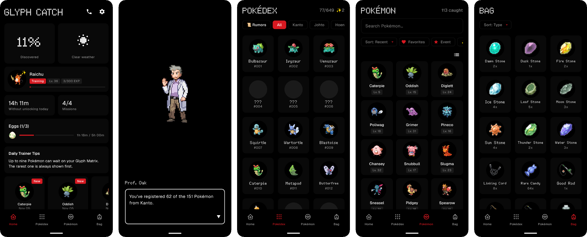
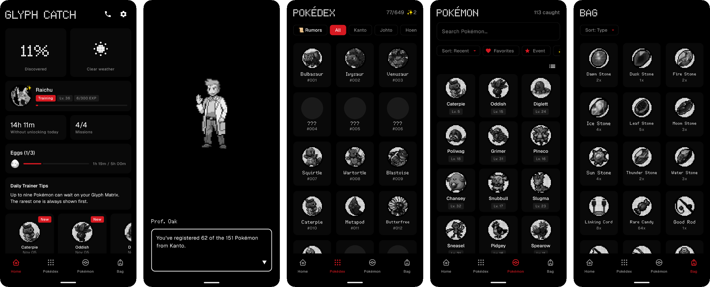

# Glyph Catch

> [!IMPORTANT]
> This is an unofficial fan project and is not affiliated with, endorsed by, or associated with Nintendo, The Pokémon Company, or Game Freak. Pokémon and all related trademarks are © Nintendo/Creatures Inc./GAME FREAK inc.

## Pokémon collecting fan-game for Nothing Phone 3 Glyph Matrix

> #### [⬇️ Download APK](https://github.com/ErikPeTo1/glyph-catch/releases/latest)
>
> **Make sure to configure Glyph Catch as your Always-on Glyph Toy.**
>
> Latest version: v3.3.0 · [What's new](CHANGELOG.md)
>
> The app lets you know when a new version is out. For automatic updates, add this repository to [Obtainium](https://github.com/ImranR98/Obtainium).


Glyph Catch is a fan-made Pokémon catching game for the Nothing Phone 3 that rewards you for reducing screen time! Leave your phone down a while, and Pokémon appear on your Glyph Matrix. The longer your phone stays locked, the higher your chance of rare encounters. Press the touch button to catch the Pokémon and build your Pokédex!



## Features

- **649 Pokémon, from Kanto to Unova.** They appear based on real-world conditions: weather boosts certain types, Zubat and Hoothoot come out at night, Castform changes with the weather and Deerling with the season.
- **A professor for every region.** Professor Oak welcomes you to Kanto. As your Pokédex grows, Professors Elm, Birch, Rowan and Juniper open Johto, Hoenn, Sinnoh and Unova. Call them on the Pokégear for your progress and the latest rumors.
- **Legendary Pokémon with their key items,** like the Eon Ticket or the Meteorite, each with its own conditions to appear.
- **Training and evolution.** Your training partner gains EXP while your phone is face-down. Evolution stones, Rare Candies, the Linking Cord and an Everstone toggle.
- **Eggs.** Baby Pokémon only hatch from Eggs, while your phone stays locked.
- **Shinies.** 1 in 512 wild Pokémon, more during holidays, and the Shiny Charm for completing the Pokédex.
- **Fishing rods, missions and statistics,** with daily and weekly rewards.
- **Color or Glyph Matrix style** in the app, your choice.
- **Six languages:** English, Spanish, German, French, Italian and Portuguese.

When there are no Pokémon around to catch, the Glyph Toy displays a handy digital clock instead.

<details>
<summary>Screenshots in the black-and-white Glyph Matrix style</summary>



</details>

## Q&A

### Can I fail catches?

No: when you throw a Poké Ball, you have a 100% chance of catching the Pokémon. Glyph Catch is designed to be consistently rewarding and stress-free. Up to nine Pokémon can accumulate, and they stay indefinitely, even if you do unlock your phone after. The only chance element is finding Pokémon.

### What if the phone is in my pocket instead of face-down?

That's fine: as long as your phone stays locked, it counts. You won't lose your streak by turning on the screen to check the time or a notification; only unlocking the phone resets it.

### Won't I just accumulate a ton of Pokémon overnight?

Pokémon keep appearing quietly during bedtime, without animations, so you may wake up to a full queue of up to nine. You can adjust your sleep schedule in the settings menu. If you sleep at least 6 hours without unlocking your phone, you'll be well rested: a bonus chance of rare encounters the next day.

### Does this impact my battery life?

Not noticeably. And if you actually end up using your phone for just a few minutes less per day, that's almost certainly a net gain for battery life.

### Can I set a dark background for the Glyph Toy?

No - the source sprites would need manual reworking for dark backgrounds (shading, outlines), on top of adapting them to the 25x25 monochrome display. With 649 Pokémon, it's beyond the scope of this fan project.

However: if you prefer, you can dim the sprite and background slightly under Settings > Glyph Toy.

### No Pokémon are appearing for me, what's wrong?

Make sure you configured Glyph Catch as your Always-on Glyph Toy: open Android settings > Glyph Interface > Glyph Toys > ⚙️ > Always-on Glyph Toys and pick Glyph Catch. It is recommended to set the timeout to 1 minute or less.

Pokémon can start appearing after about 8 minutes without unlocking your phone, and one is guaranteed after 30.

Note that Essential Notifications may disconnect the Glyph Toy and disrupt the timer. If you are getting too many Essential Notifications, consider scheduling quiet time in apps that support it and/or narrowing the Essential Notification rules.

### Can I keep my progress from the original Glyph Catch?

Unfortunately not: this version is a separate app, so it installs alongside the original and starts a fresh save. From now on, you can back up your progress under Settings > Backup.

## Building

Requires JDK 21.

```bash
./gradlew :app:assembleDebug     # Build a debug APK
./gradlew :app:installDebug      # Install on a connected phone
./gradlew :app:testDebugUnitTest # Run unit tests
./gradlew :app:ktlintCheck       # Check code style
```

Translations live in `tools/i18n` and are generated with `node tools/i18n/build.js`.

## Credits

Glyph Catch was created by **[Equal Parts](https://github.com/equalparts/glyph-catch)**, including the original Kanto sprites hand-made for the Glyph Matrix. This fork continues the app with the original author's written permission and encouragement. Thank you, Equal Parts!

Gen 2-5 sprites, item sprites, Pokémon data and official names in each language come from [PokeAPI](https://pokeapi.co/). Professor and character sprites come from [Pokémon Showdown](https://play.pokemonshowdown.com/sprites/trainers/), and the Pokédex sprite from [Bulbagarden Archives](https://archives.bulbagarden.net/).

## Privacy

Glyph Catch does not collect any personal data.

Once a day, the app checks this repository's GitHub Releases to tell you when a new version is available. Only the public release information is requested; nothing about you or your game is sent.

Live weather sync uses the popular OpenWeatherMap API with a geographical location that you configure, no live location. Refer to the [OpenWeatherMap privacy policy](https://openweather.co.uk/privacy-policy) for details.

There is a "Save logs" option (off by default) under "Debugging" for troubleshooting purposes. If enabled, these logs are saved locally on your device, not automatically sent to a server. You can inspect or delete the logs at any point.
