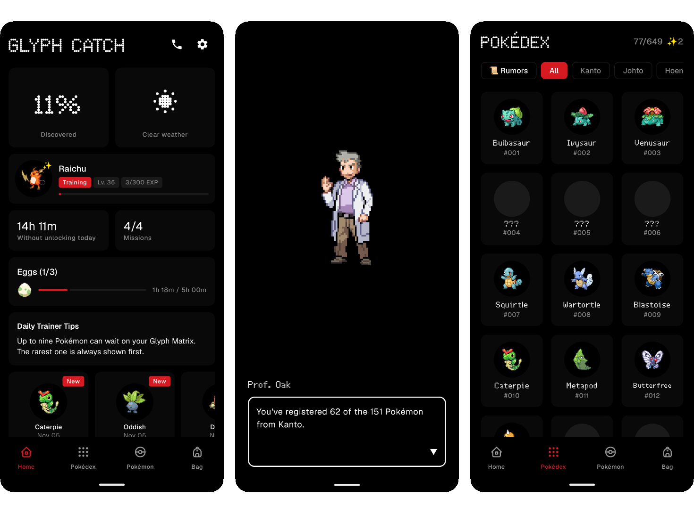
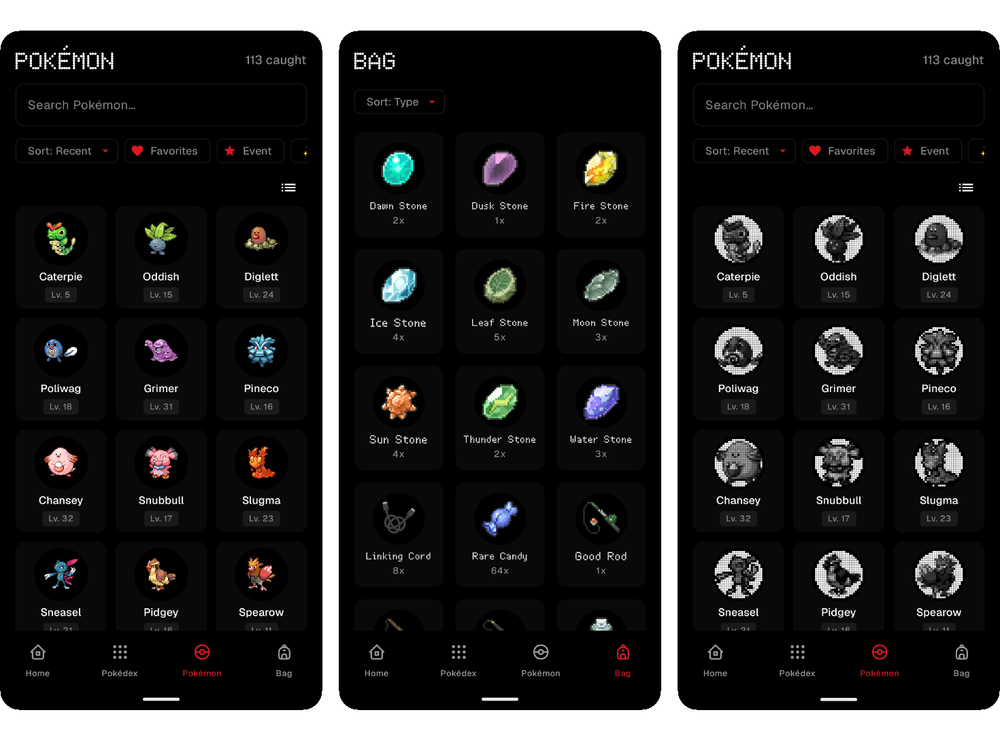

# Glyph Catch

> [!IMPORTANT]
> Unofficial fan project, not affiliated with Nintendo, The Pokémon Company or Game Freak. Pokémon © Nintendo/Creatures Inc./GAME FREAK inc.

A Pokémon catching game for the Nothing Phone (3) Glyph Matrix. Leave your phone face-down and Pokémon appear on the Glyph Matrix. Long-press to catch them.

### [⬇️ Download](https://github.com/ErikPeTo1/glyph-catch/releases/latest) · [What's new](CHANGELOG.md) · [FAQ](FAQ.md)

Set Glyph Catch as your **Always-on Glyph Toy**. The app tells you when there's an update, or add this repository to [Obtainium](https://github.com/ImranR98/Obtainium).

- All 649 Pokémon, from Kanto to Unova
- Professors who unlock each region and call you with rumors
- Shinies, eggs and legendary Pokémon with their own items
- Charge your phone and Electric types show up

Free, no ads, no data collected.

## Credits

Created by **[Equal Parts](https://github.com/equalparts/glyph-catch)**, including the hand-made Kanto sprites, and continued here with his permission. Sprites and data from [PokeAPI](https://pokeapi.co/), [Pokémon Showdown](https://play.pokemonshowdown.com/sprites/trainers/) and [Bulbagarden Archives](https://archives.bulbagarden.net/).
